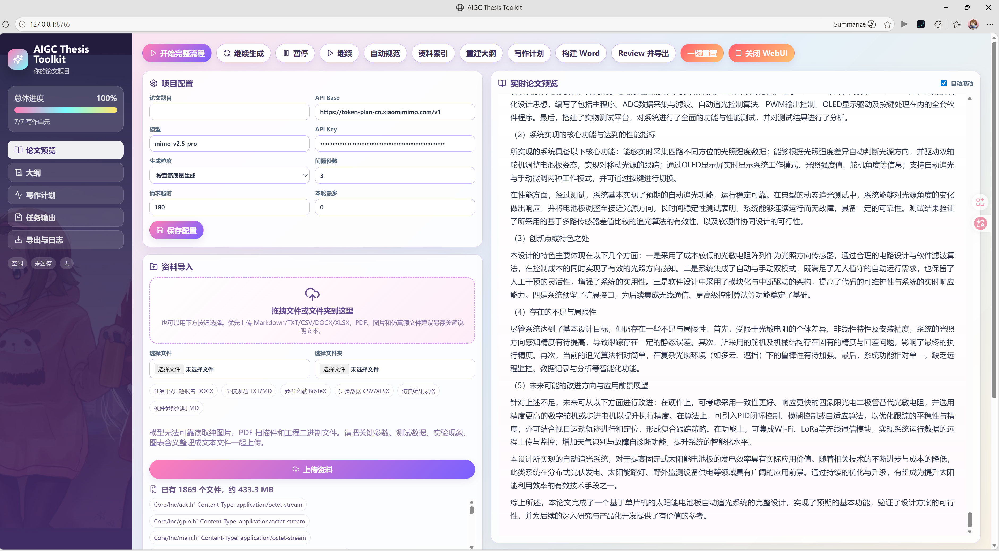

# AIGC Thesis Toolkit

[简体中文](README.md) | **English**

An AI-assisted workspace that turns reference materials, university requirements, and real experimental data into thesis outlines, chapter drafts, Word documents, and defense slides.

Bring your materials and API credentials, manage the workflow in a browser, and review, edit, or resume your drafts as you go.



## What it does

| Feature | Purpose |
| --- | --- |
| Resource indexing | Extract information from uploaded materials into a readable resource index |
| Guidelines and outlines | Generate or import writing requirements and plan chapters from your materials |
| Chapter drafting | Draft chapters with saved progress, pause/resume, and live previews |
| Review and export | Review chapters, assemble Markdown, and export DOCX using a Word template |
| Defense slides | Create a PPTX draft from the generated thesis or an external paper, with reference slide styles |
| Model connections | Connect a Chat Completions-compatible service using an API base, key, and model name |

## Quick start

Use **Ubuntu/WSL or Linux**. Python 3.10+ with `venv` is recommended; also install Node.js 18+ and npm. The complete Word export workflow requires Bash; macOS and native Windows may need script compatibility adjustments.

### 1. Install and launch

```bash
git clone https://github.com/Epiphany-Leave/aigc-thesis-toolkit.git
cd aigc-thesis-toolkit
```

On Ubuntu/WSL, install system tools with the helper script (uses sudo and installs Node.js when needed):

```bash
bash scripts/install_system_deps_ubuntu.sh
```

Install Python dependencies and initialize the workspace:

```bash
python3 -m venv .venv
source .venv/bin/activate
python -m pip install -r requirements.txt
python workflow.py init
```

Build the WebUI and start the server:

```bash
cd workflows/webui/frontend
npm ci
npm run build
cd ../../..
python workflow.py ui
```

Open **http://127.0.0.1:8765**. If that port is busy, use the address printed in the terminal. Rebuild the frontend after installation or updates; for everyday use, run `python workflow.py ui`.

Run `python workflow.py doctor` to diagnose missing dependencies. Pandoc for Word export is supplied by `pypandoc-binary`. PDF extraction, image OCR, and legacy Word files need additional system tools; see the [detailed guide (Chinese)](docs/USAGE.zh-CN.md).

### 2. Use the workspace

1. **Configure** the thesis title, API base, API key, model, and target length.
2. **Import** references, formatting requirements, proposals, and real experiment data. Add text explanations for images, scans, or simulation projects.
3. **Prepare** the resource index and writing guidelines, then check the outline and chapter plan.
4. **Draft and review** through the full workflow or resume unfinished work; check and edit each chapter.
5. **Export** Markdown or Word, or open the PPT page to create a defense presentation draft.

Thesis figures default to placeholders and captions. Full-slide AI images for PPT require an image-capable API and model; the writing API's address and key can be reused.

## Where files live

| Path | Contents |
| --- | --- |
| [`workflow.py`](workflow.py) | CLI entry point; run `python workflow.py --help` for commands |
| [`configs/`](configs/) | Defaults and examples; private settings go in `configs/local.yaml` |
| [`user_data/`](user_data/) | Imported materials and the generated resource index |
| [`thesis/`](thesis/) | Guidelines, outline, chapters, progress, and logs |
| [`template/reference.docx`](template/reference.docx) | Word style template |
| [`output/`](output/) | Thesis Markdown, Word, slides, and review reports |
| [`workflows/`](workflows/) | Writing, export, PPT, review, and WebUI implementation |

Typical outputs are `output/thesis.md`, `output/thesis.docx`, and `output/thesis_presentation.pptx`.

## Before you use it

- The UI and files are local. AI calls send relevant materials or context to your configured API provider and may incur charges.
- API credentials, personal materials, and generated content are ignored by Git by default; inspect your changes before committing.
- Generated work is a draft. Check facts, formulas, citations, experimental conclusions, and formatting yourself.

For advanced configuration, CLI usage, development mode, and troubleshooting, see the [detailed guide (Chinese)](docs/USAGE.zh-CN.md). Licensed under the [MIT License](LICENSE).
