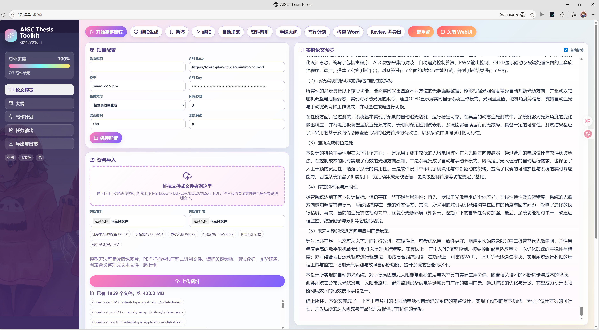

# AIGC Thesis Toolkit

**简体中文** | [English](README.en.md)

> [!NOTE]
> **项目状态：仅保留开发记录。** 本项目在 Codex 桌面版及同类工具问世之前开发，原本用于把长文生成、续写和导出串成一套流程。如今，这些任务可以直接用 Codex 等工具完成，本项目已不再有作为独立工具的实用价值，不建议用于新项目。

把参考资料、学校格式要求和真实实验数据，整理成论文大纲、章节初稿、Word 文档与答辩 PPT 的 AI 辅助工作台。

你提供资料和 API 配置，在浏览器中完成写作流程，并随时检查、修改和继续生成。



## 能做什么

| 功能 | 用途 |
| --- | --- |
| 资料索引 | 从上传资料中抽取信息，生成可查阅的资料索引 |
| 规范与大纲 | 根据学校要求和参考资料生成或导入写作规范、规划章节 |
| 分章写作 | 按章生成正文，支持进度记录、暂停、续写和实时预览 |
| 审阅与导出 | 审阅章节，合并 Markdown，并通过 Word 模板导出 DOCX |
| 答辩 PPT | 从生成的论文或外部论文制作 PPTX 初稿，可导入参考 PPT 样式 |
| 模型接入 | 通过 API Base、API Key、模型名称接入兼容 Chat Completions 的服务 |

## 快速开始

建议使用 **Ubuntu／WSL 或 Linux**，推荐 Python 3.10+（支持 `venv`），并安装 Node.js 18+ 和 npm。完整 Word 导出依赖 Bash；macOS 和原生 Windows 需自行处理脚本兼容性。

### 1. 下载并安装

```bash
git clone https://github.com/Epiphany-Leave/aigc-thesis-toolkit.git
cd aigc-thesis-toolkit
```

Ubuntu／WSL 可运行系统依赖安装脚本（会使用 sudo，并在需要时安装 Node.js）：

```bash
bash scripts/install_system_deps_ubuntu.sh
```

安装 Python 依赖并初始化：

```bash
python3 -m venv .venv
source .venv/bin/activate
python -m pip install -r requirements.txt
python workflow.py init
```

构建 WebUI，然后启动服务：

```bash
cd workflows/webui/frontend
npm ci
npm run build
cd ../../..
python workflow.py ui
```

打开 **http://127.0.0.1:8765**；端口被占用时，以终端输出的地址为准。前端只需在首次安装或更新后重新构建，日常启动运行 `python workflow.py ui` 即可。

依赖问题可运行 `python workflow.py doctor` 排查。Word 导出所需的 Pandoc 由 `pypandoc-binary` 提供；PDF、图片 OCR 和老版 Word 读取还需要对应系统工具，见[详细使用指南](docs/USAGE.zh-CN.md)。

### 2. 开始使用

1. **配置项目**：填写论文题目、API Base、API Key、模型名称及目标字数。
2. **导入资料**：上传参考文献、格式要求、开题报告和真实实验数据；图片、扫描件或仿真工程建议附文字说明。
3. **准备写作**：生成资料索引，生成或导入写作规范，核对大纲和写作计划。
4. **生成并检查**：开始完整流程或继续生成，检查每章内容，按需审阅、修改。
5. **导出成果**：下载 Markdown／Word，或进入“PPT生成”页面制作答辩 PPT 初稿。

论文插图默认保留占位与题注。PPT 的“整页 AI 图片”模式需要支持图像生成的接口与模型，可复用写作 API 的地址和密钥。

## 文件在哪里

| 路径 | 内容 |
| --- | --- |
| [`workflow.py`](workflow.py) | 命令行入口；可用 `python workflow.py --help` 查看命令 |
| [`configs/`](configs/) | 默认配置与示例；私有配置保存为 `configs/local.yaml` |
| [`user_data/`](user_data/) | 上传资料与生成的资料索引 |
| [`thesis/`](thesis/) | 写作规范、大纲、章节、进度与日志 |
| [`template/reference.docx`](template/reference.docx) | Word 样式模板 |
| [`output/`](output/) | 论文 Markdown、Word、PPT 和审阅报告 |
| [`workflows/`](workflows/) | 写作、导出、PPT、审阅与 WebUI 实现 |

常用成果为 `output/thesis.md`、`output/thesis.docx` 和 `output/thesis_presentation.pptx`。

## 使用前须知

- 界面与文件保存在本地；调用 AI 时，相关资料或上下文会发送给所配置的 API 服务商，并可能产生费用。
- API Key、个人资料和生成内容默认被 Git 忽略，提交前仍应检查文件列表。
- 生成结果是初稿，数据、公式、引用、实验结论和格式需人工核查。

更多配置、命令行、开发模式和故障处理见[详细使用指南](docs/USAGE.zh-CN.md)。项目采用 [MIT License](LICENSE)。
